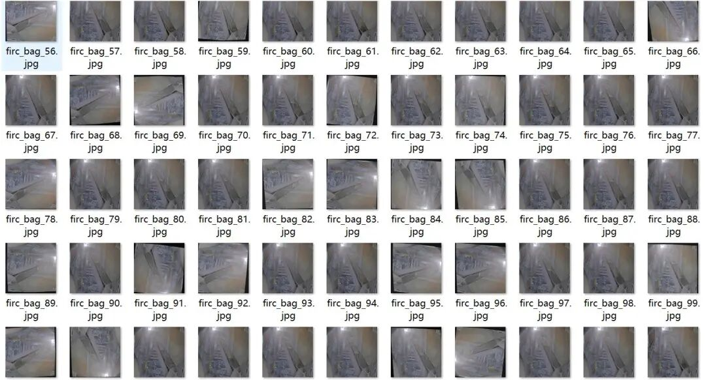
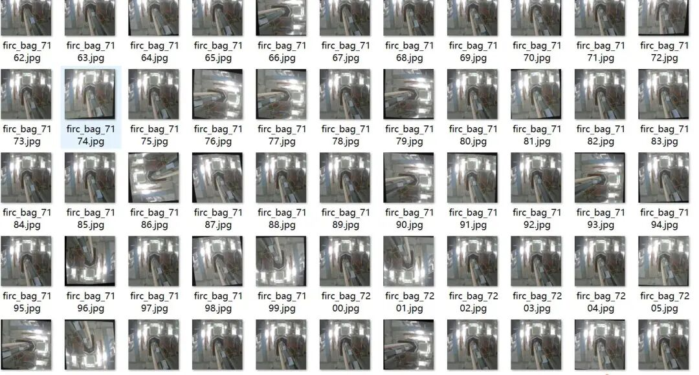
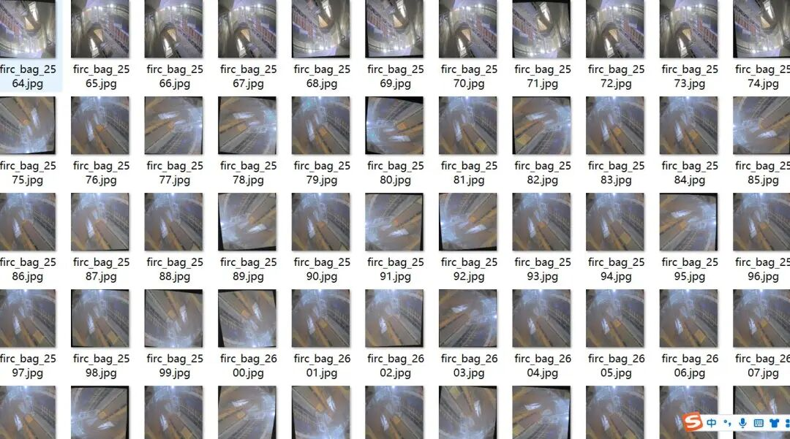
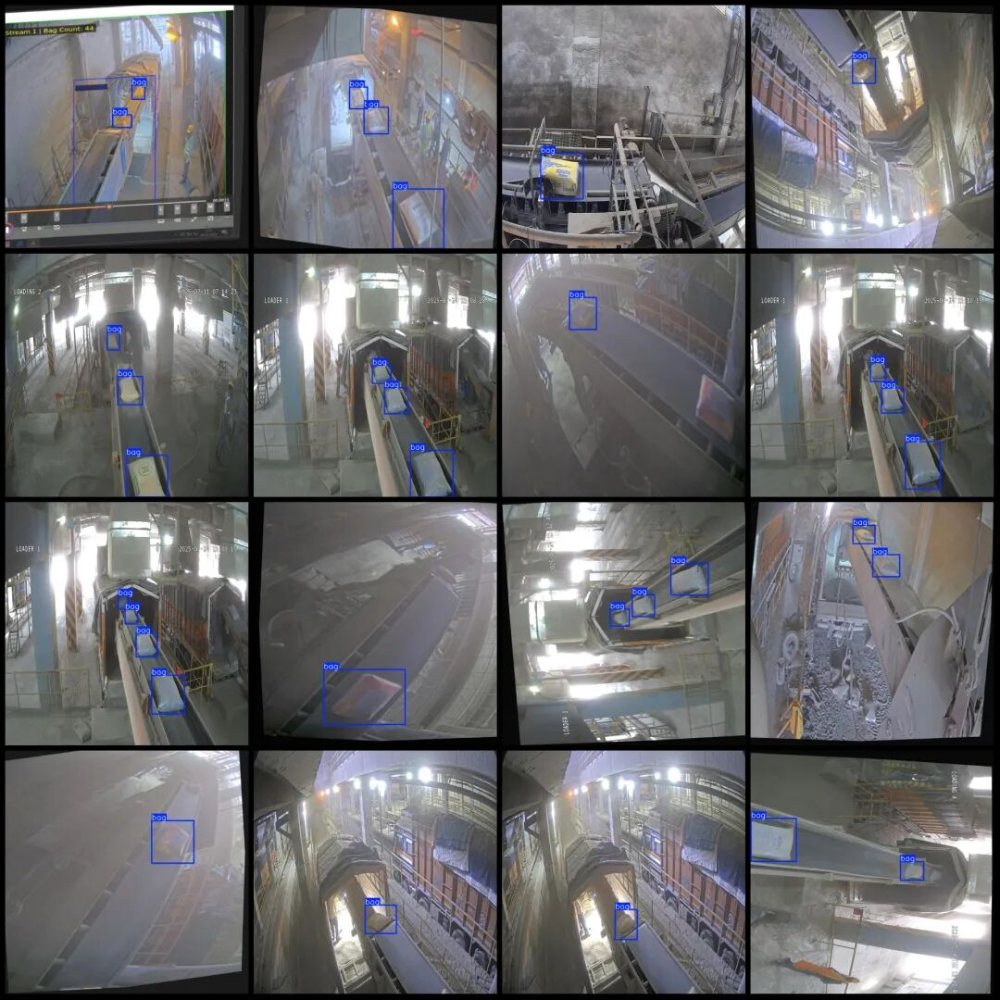

# Transfer belt package detection and counting dataset in VOC+YOLO format with 8864 images in 2 categories

Dataset format: Pascal VOC format + YOLO format (txt file without split path, only containing jpg images and corresponding VOC format xml files and yolo format txt files)

Number of images (number of jpg files): 8864

Number of annotations (number of xml files): 8864

Number of annotations (number of txt files): 8864

Labeling category count: 2

Image resolution: 640x640

Is the dataset enhanced? Yes, approximately 4700 images are originals with the remaining being enhanced images, mainly rotation enhancements.

Label category names (note that the order of yolo format categories does not correspond to this, but is based on the classes.txt in the labels folder): ["bag", "fitting"]

Number of boxes labeled in each category:

Bag (Various Packages) Frame Count = 16632

Fitting (at the exchange interface of conveyor belt wrapping) Frames = 367

Total frame count: 16999

Using labelImg:

Annotation rules: Draw a rectangle around the category.

Important Notice: No

Special : This dataset does not guarantee the accuracy of the trained models or weight files.

Image Preview:

Annotation example (randomly select 16 examples to show the annotation situation):

## Payment

Here is a pay link on Stripe ( https://buy.stripe.com/3cs8yP7sY87d0vu9AB ). Please contact me lonlonago@foxmail.com after funding $89, and I will send you a complete data files , thank you!

